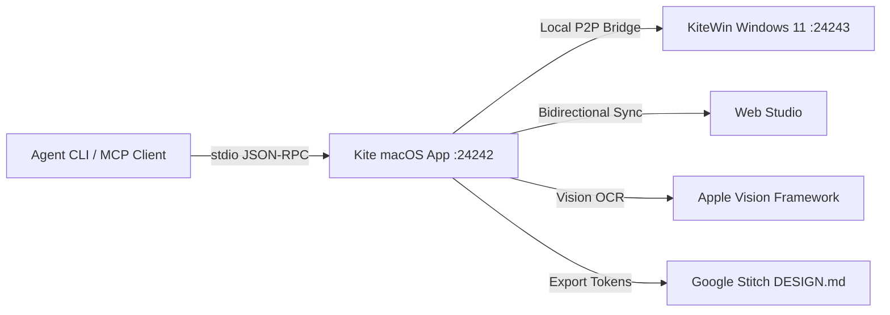

# Kite for macOS

**The Sovereign Studio for Ideas, Architecture, and Antigravity Skills**

[](https://github.com/Tasonai/Kite/releases/tag/v1.1.0)
[](https://github.com/Tasonai/Kite/releases)
[](#craftsmanship-and-quality-gates)
[-success.svg)](#craftsmanship-and-quality-gates)
[](#craftsmanship-and-quality-gates)

---

## 1. Overview

Kite is a high-craft desktop application and idea banking system built natively for macOS with Swift 6, SwiftUI, and SwiftData. It provides engineering teams and AI agents with an offline-first workspace for capturing project concepts, mapping design architecture on an infinite canvas, and commanding 355 specialized Antigravity engineering skills.

Kite integrates with Windows 11 (`KiteWin`) and the Web Studio via a peer-to-peer (P2P) local synchronization bridge powered by `Network.framework`.



---

## 2. Key Capabilities

### 2.1. Native macOS Craftsmanship
- **Swift 6 & SwiftUI**: Fully native 4pt/8pt modular grid, responsive 3-column split view, and sub-250ms spring transitions.
- **Daemon Menu Bar & Global Hotkey**: `Cmd+Shift+K` invokes the Spotlight-style Quick Capture HUD from anywhere in macOS using the Carbon Events API.
- **Background Persistence**: Local offline database powered by SwiftData (`Kite.store`) with WAL journaling.

### 2.2. Antigravity Skills Catalog (355 Skills & 18 Plugins)
- Comprehensive catalog covering Frontend, Cloud, Systems, Accessibility, and Design Craft.
- All commands, activation triggers, and example prompts strictly formatted with slash syntax:
  - `/site-md` — Project constitution and screen mapping
  - `/design-md` — Semantic design system tokens in Markdown
  - `/taste-design` — Intentional typography and aesthetic curation
  - `/emil-design-eng` — Physical spring micro-interactions and tactile feedback
  - `/a11y-debugging` — WCAG AA compliance and focus state auditing
  - `/gsd-execute-phase` — Wave-based execution with atomic commits

### 2.3. Infinite Visual Canvas & Token Exporter
- Freeform canvas supporting Pan & Zoom (`60%` - `160%`).
- Draggable Idea nodes, Color-coded Sticky notes, and Reference cards (Mobbin, Figma).
- Curved Bezier connector lines with semantic relationship pills (`HIG 4pt`, `Sync`).
- One-click export directly to **Google Stitch** (`DESIGN.md`) and **Figma** (W3C Design Tokens JSON).

### 2.4. Screen Snip & Apple Vision OCR
- One-click interactive area capture (`screencapture -i -s`).
- On-device text recognition via `VNRecognizeTextRequest` (Russian and English).
- Automatically converts captured interfaces into Reference Cards placed on the infinite canvas.

### 2.5. Project Scaffolding 2.0
- One-click project generation from idea blueprints:
  - Generates `README.md`, `SPEC.md`, `PLAN.md`, `DESIGN.md`, and `CLAUDE.md`.
  - Scaffolds platform code: `package.json` for React 19 / Vite Web apps, `Package.swift` for native Swift apps.
  - Automatically initializes local Git repository.

---

## 3. Installation & Downloads

Pre-built installers are on the [Releases page](https://github.com/Tasonai/Kite/releases/tag/v1.1.0).

> [!IMPORTANT]
> - The build is **Intel (`x86_64`) only**. There is no Apple Silicon build yet.
> - It requires **macOS 26 or later** (`LSMinimumSystemVersion` in `Info.plist`).
> - It is signed with a development certificate and **not notarized**, so Gatekeeper blocks the first launch. Right-click the app and choose Open, or run `xattr -dr com.apple.quarantine /Applications/Kite.app`.

| Package | Format | Architecture | Download |
| :--- | :--- | :--- | :--- |
| **Kite macOS Disk Image** | `.dmg` | Intel (x86_64) | [Download DMG](https://github.com/Tasonai/Kite/releases/download/v1.1.0/Kite-1.1.0-macOS.dmg) |
| **Kite macOS Archive** | `.zip` | Intel (x86_64) | [Download ZIP](https://github.com/Tasonai/Kite/releases/download/v1.1.0/Kite-1.1.0-macOS.zip) |

### SHA256 Checksums
```text
8bb8f5ae06ea3e208df1790dbaa45a07a92019b7ee7834a5887f20d98948fb58  Kite-1.1.0-macOS.dmg
2136ab68793c1f17cd956c26d2c105c1b9f1673c596c7afbd56f0618e63df3e4  Kite-1.1.0-macOS.zip
```

---

## 4. Agent CLI & Model Context Protocol (MCP)

Kite includes a command-line tool and standard Model Context Protocol (MCP) server installed at `/usr/local/bin/kite`.

### 4.1. CLI Commands
```bash
# Check station health and connection status
kite status

# List ideas stored in the local SwiftData bank
kite list --platform web --status in_progress

# Add a new idea live into the running app
kite add "Distributed Tracing" --platform desktop --style "Enterprise & Terminal Monospace" --starred

# Export infinite canvas layout and tokens
kite canvas --format stitch
```

### 4.2. MCP Configuration
To connect Kite to Claude Desktop, Cursor, or Antigravity, add the following to your MCP configuration file (`claude_desktop_config.json` or `mcp_config.json`):

```json
{
  "mcpServers": {
    "kite": {
      "command": "/usr/local/bin/kite",
      "args": ["mcp"]
    }
  }
}
```

#### Available MCP Tools
- `kite_status`: Inspect running station status, active port, and item counts.
- `kite_list_ideas`: Query ideas with status and platform filters.
- `kite_add_idea`: Create architectural blueprints directly in the running app.
- `kite_export_canvas`: Stream canvas layout and design tokens.

---

## 5. Craftsmanship and Quality Gates

Kite adheres to the strict BAMA (Build Anything on Mac Architecture) craftsmanship specification:
- **Zero Emojis Policy**: Strictly 100% system glyphs (SF Symbols and clean typography). Emojis are blocked by CI quality gates.
- **4pt/8pt Grid Lint**: Enforced via `tools/grid-lint.sh`. All spacing, padding, and corner radiuses must conform to the 4pt/8pt modular grid.
- **Self-Test Suite**: In-app integration tests verify SwiftData persistence, selection, and cleanup via `tools/selftest.sh`.
- **Pre-Commit Verification**: Local `.git/hooks/pre-commit` prevents commits with compiler warnings or grid regressions.

### Running Quality Gate Manually
```bash
./tools/quality_gate.sh
```

---

## 6. Building from Source

### Prerequisites
- macOS 26 or later
- Xcode 16.0 or later (Swift 6.0 toolchain)

### Build and Install
```bash
git clone https://github.com/Tasonai/Kite.git
cd Kite

# Build release and install to ~/Applications/Kite.app
./build.sh --open
```

---

## 7. License

Licensed under the MIT License.
