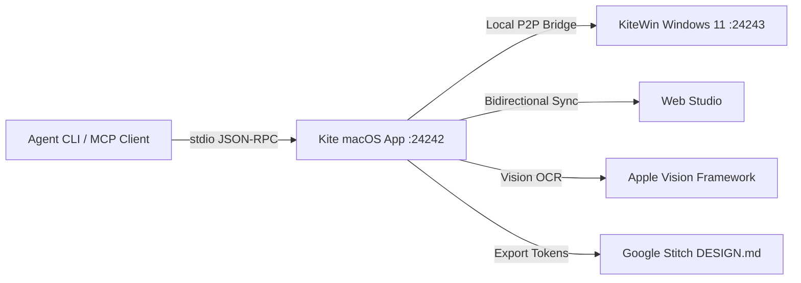

# Kite for macOS

**The Sovereign Studio for Ideas, Architecture, and Antigravity Skills**

[](https://github.com/Tasonai/Kite/releases/tag/v1.3.0)
[](https://github.com/Tasonai/Kite/releases)
[](#craftsmanship-and-quality-gates)
[-success.svg)](#craftsmanship-and-quality-gates)
[](#craftsmanship-and-quality-gates)

---

## 1. Overview

Kite is a high-craft desktop application and idea banking system built natively for macOS with Swift 6, SwiftUI, and SwiftData. It provides engineering teams and AI agents with an offline-first workspace for capturing project concepts, mapping design architecture on an infinite canvas, and commanding 355 specialized Antigravity engineering skills.

Kite integrates with Windows 11 (`KiteWin`) and the Web Studio via a peer-to-peer (P2P) local synchronization bridge powered by `Network.framework`.



---

## 2. Key Capabilities

### 2.1. 3-Pillar Information Architecture
- **Pillar 1: Проекты и бэклог (Workspace)**
  - Все идеи, В разработке, Готово, Избранное.
- **Pillar 2: Архитектура и синтез (Engineering Core)**
  - Холст топологии, Промпт-переводчик, AI-Советник, База скиллов.
- **Pillar 3: Дизайн и интеграции (Ecosystem)**
  - Лаборатория дизайна, Галерея вдохновения, Стили и токены, Синхронизация P2P.

### 2.2. 4-Wave Engineering Hub (32+ Studios)
Integrated into the Prompt Translator and available via the macOS `Инженерия` menu bar:
- **Wave 1: Схема и Данные**: Data Schema Designer (PostgreSQL/Prisma), Model Router (Gemini 3.8), Index Optimizer (zero-downtime DDL), Seed Data Generator, Vector Store Specifier (pgvector), Migration Strategist (Expand & Contract).
- **Wave 2: Сервисы и API**: API Contract Builder, Typed RPC (tRPC), EventBus Studio, Job Queue Strategist, Rate Limiter (Upstash Redis), Query Cache Studio, Realtime WebSockets, Webhook Simulator, Webhook Dispatcher.
- **Wave 3: UI и Токены**: Token Sandbox, StateFlow Simulator (XState), Sitemap Router Builder, Accessibility Auditor (WCAG 2.2 AAA), SEO Studio (Next.js Metadata), Interactive Mockup Generator.
- **Wave 4: QA и Релиз**: Antigravity Pack (4 Waves), Canvas Topology Validator, Terminal Error Doctor, Threat Modeler (OWASP STRIDE), Secret Shield, Eval Harness (Vitest), Conventional Commits & PR, Deploy Blueprints (Vercel/Docker), Incident Commander, Stress Test (k6), Developer Runbook.

### 2.3. Topology Canvas & Live Dataflow Simulation
- Infinite freeform canvas with subgraphs and draggable node cards.
- Cubic Bezier connector lines with semantic protocol badges (`tRPC`, `EventBus`, `SQL`).
- **Live 25 FPS Simulation Mode**: Animated throughput particles and real-time RPS/QPS metrics streaming across node connections.
- Direct export to **Google Stitch** (`DESIGN.md`), **Figma** (Tokens JSON), and **Mermaid** diagrams.

### 2.4. Apple HIG Monochrome Design System
- Pure neutral monochromatic palette: Dark (`#1C1C1E` / `#2C2C2E`) and Light (`#F2F2F7` / `#FFFFFF`).
- Strict 4pt/8pt grid metrics and fluid spring micro-interactions.
- Absolute zero emojis across code, logs, and interfaces (100% SF Pro Symbols).

### 2.5. Model Context Protocol (MCP) & Agent CLI Bridge
- Standard JSON-RPC stdio MCP server (`kite mcp`) for Claude Desktop, Cursor, and Antigravity.
- Local command line utility (`/usr/local/bin/kite`) for automated idea injection, co-architect canvas generation, and spec extraction without GUI interaction.

---

## 3. Installation & Downloads

Pre-built signed installers are available on the [Releases page](https://github.com/Tasonai/Kite/releases/tag/v1.3.0):

| Package | Format | Architecture | Download |
| :--- | :--- | :--- | :--- |
| **Kite DMG Installer** | `.dmg` | macOS 26+ (Intel x86_64 / Apple Silicon via Rosetta) | [Download DMG](https://github.com/Tasonai/Kite/releases/download/v1.3.0/Kite-1.3.0-macOS.dmg) |
| **Kite Standalone Archive** | `.zip` | macOS 26+ (Standalone Application) | [Download ZIP](https://github.com/Tasonai/Kite/releases/download/v1.3.0/Kite-1.3.0-macOS.zip) |

---

## 4. Craftsmanship and Quality Gates

Kite enforces strict automated quality gates verified on every commit:

```bash
./tools/quality_gate.sh
```

1. **Apple HIG 4pt/8pt Grid Lint**: Verifies padding, margins, frame sizes, and corner radiuses.
2. **Zero Emojis Audit**: Strictly forbids pictorial emojis, enforcing system glyphs.
3. **Swift Release Compilation**: Zero warnings with Swift 6 and strict concurrency checking.
4. **SwiftData Self-Test**: 110 automated in-memory integrity and UI checks.
